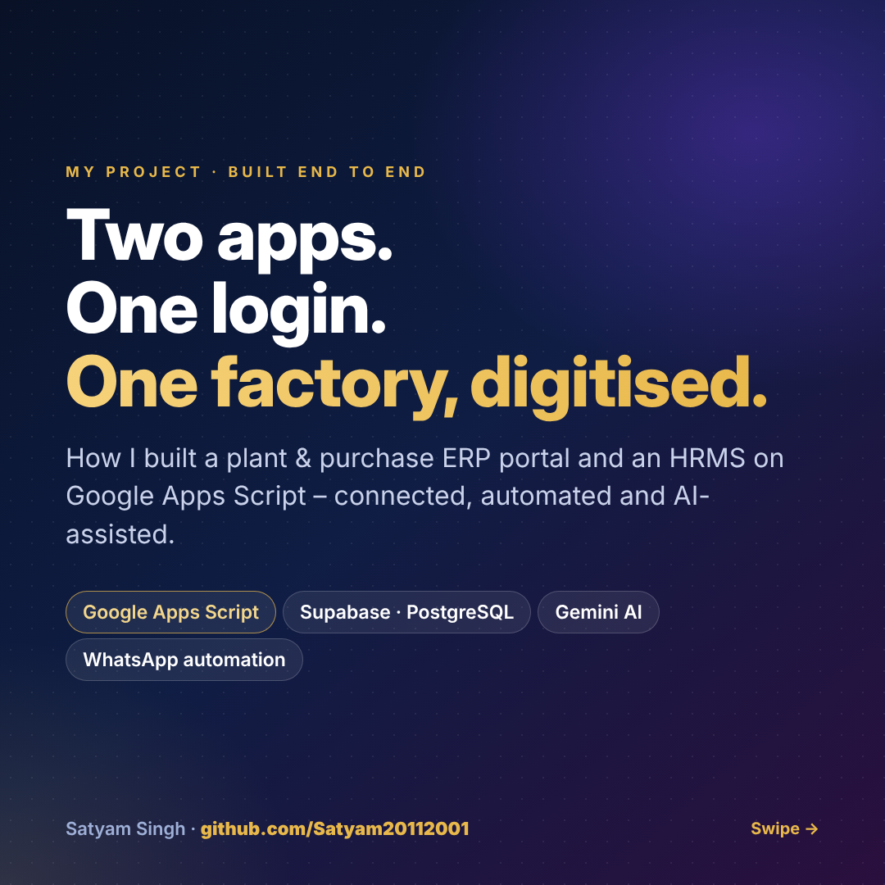
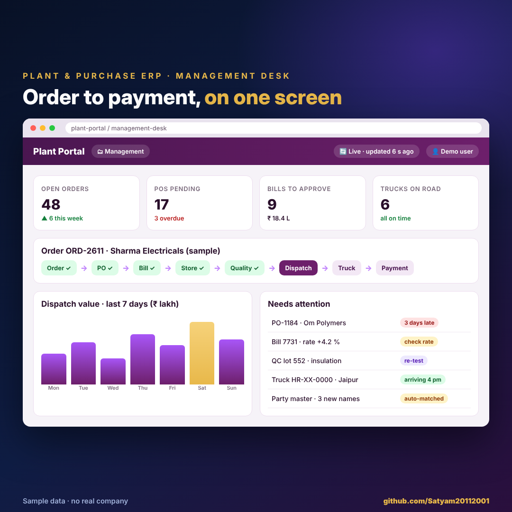
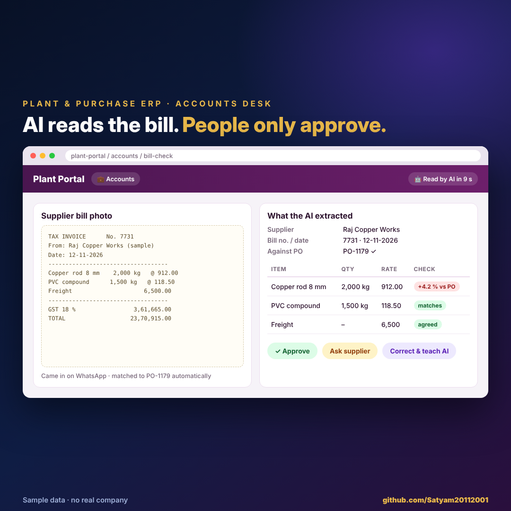
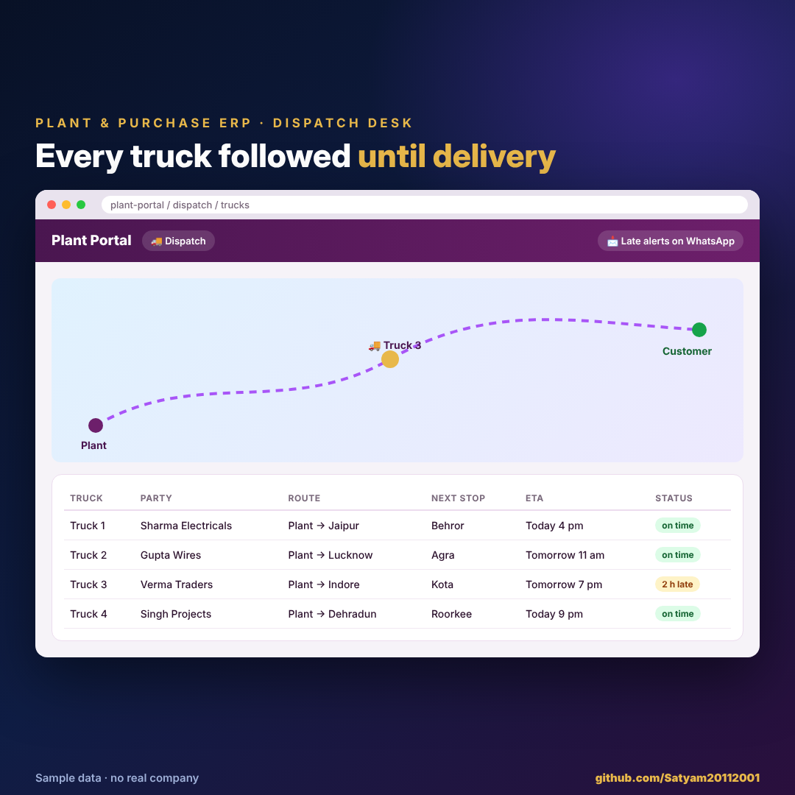
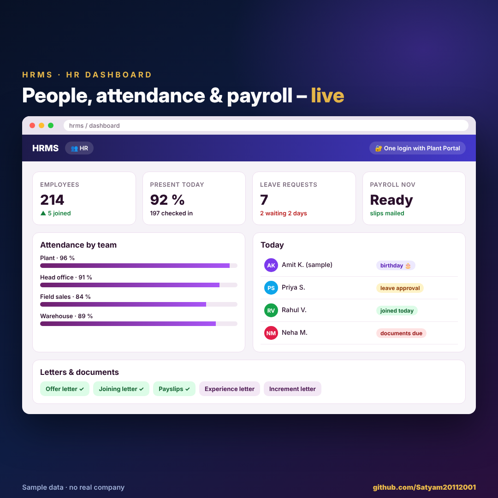
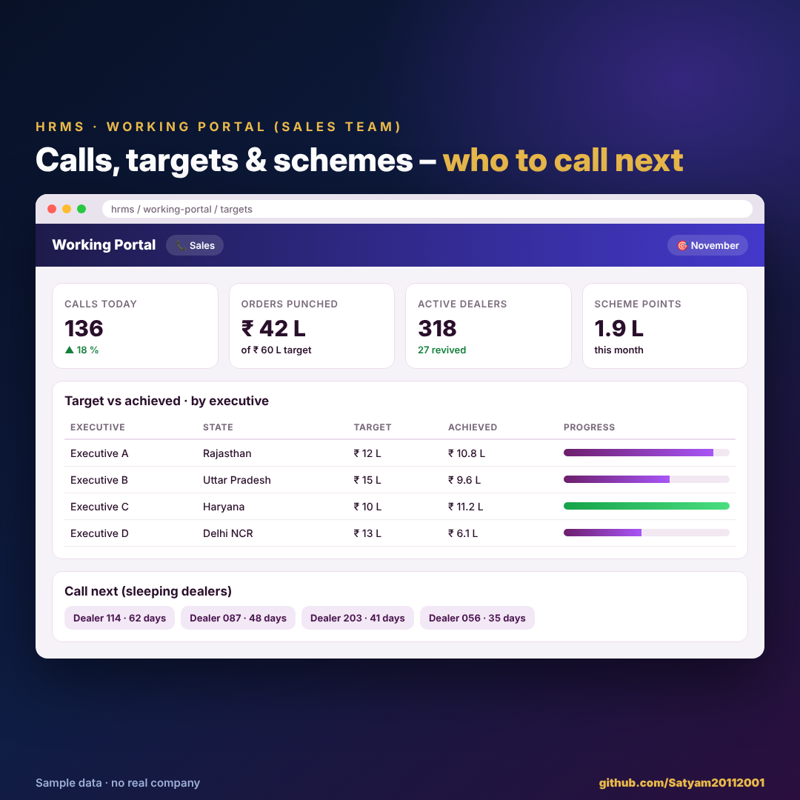

<h1 align="center">Plant ERP & HRMS – two business apps, one login</h1>

<b>Google Apps Script · Google Sheets · Supabase (PostgreSQL) · Gemini / Ollama AI · WhatsApp & e-mail automation</b>

  
  

A showcase of two connected web apps I designed and built end to end for a manufacturing business: a **plant & purchase ERP portal** and an **HRMS & sales working portal**. They run on tools the team already had (Google Workspace), with no ERP licence.

> The source code and data are private. All screenshots here use **invented sample data**, and no real company, person or number is shown.

---

## 1. Plant & Purchase ERP portal

One web portal with a desk for each department: store, accounts, quality, dispatch, audit, management and plant MIS. It works on phone and desktop.

| | |
|---|---|
|  | **Order to payment on one screen** Order → PO → supplier bill → store → quality → gate → dispatch → truck → payment. KPI cards, a "needs attention" list, and screens that refresh themselves every 5–10 s. |
|  | **AI reads supplier bills** Bills, transport LRs and weighbridge slips arrive by WhatsApp, e-mail or phone photo. Gemini reads them, with a local Ollama model as backup. Rates are checked against the PO and differences are flagged. People only approve or correct, and the corrections teach the AI. |
|  | **Every truck followed until delivery** Route, next stop and ETA for each truck, with a WhatsApp alert when a truck is late. |

**Under the hood**
- 112 data tables behind one set of screens, with role-based desks and access.
- Connected to the accounting software's data, with a shared party master that matches names automatically.
- A Supabase (PostgreSQL) read layer takes the load off Google Sheets, so many users can work at once.
- Housekeeping trims unused sheet space and moves old log rows to a verified backup or the database, so no file reaches the 20-million-cell limit.
- Weekly security lock, owner-only master data, and secrets kept only in script properties.

## 2. HRMS & Working Portal

| | |
|---|---|
|  | **HR dashboard** Employees, attendance by team, leave approvals, payroll and payslips, plus offer, joining, experience and increment letters. |
|  | **Sales working portal** Calls, orders, targets vs achieved per executive, loyalty-scheme points, and a "call next" list of sleeping dealers. Daily checklists are ticked from a link. |

## 3. How the two apps work as one

1. **One username and password** for both apps. A login created or reset in either app works in both, and passwords travel only as salted hashes over signed (HMAC) calls.
2. **One-click sign-in** from the ERP portal to the HRMS. A user without a desk gets a clear "no desk assigned" screen.
3. **Shared security.** A change to the HRMS super-admin details locks the ERP portal and all its desks immediately, and the owner is mailed.
4. **Shared masters.** One employee list and one party master, kept in sync automatically.

## Tech stack

## Roadmap

What is done, in progress and next: **[Business Automation Roadmap board](https://github.com/users/Satyam20112001/projects/2)**

## Want something like this?

I build custom portals, automations and dashboards on Google Sheets / Apps Script, Power BI and SQL for small and mid-size businesses.

- 💼 Hire me on **[Fiverr](https://www.fiverr.com/satyam_singh_20)**
- 🔗 Connect on **[LinkedIn](https://www.linkedin.com/in/satyam-singh-508210213/)**
- 🔳 See also: [QR Code Studio](https://github.com/Satyam20112001/App), an open-source Python app

---
© Satyam Singh. Screenshots and text only; the apps' code is not published.
